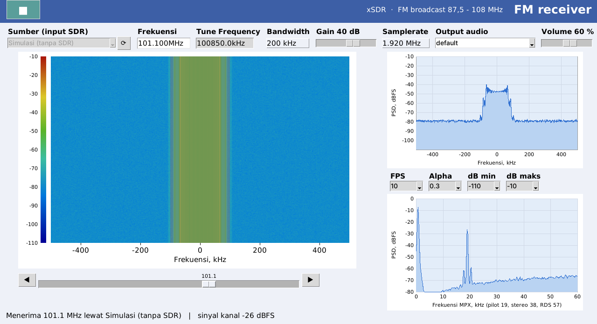
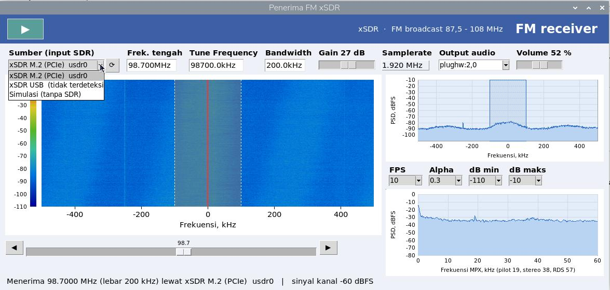
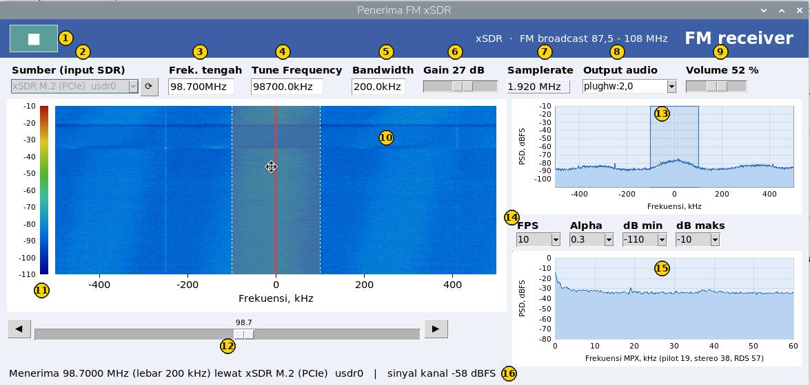
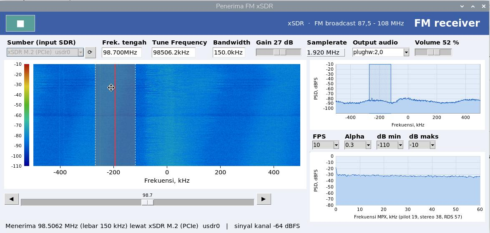
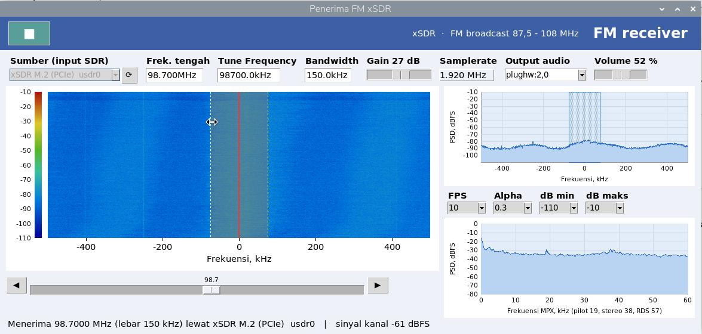

# xSDR FM Receiver untuk Raspberry Pi CM5

Kode pendamping tutorial **"Implementasi Software Defined Radio xSDR pada Raspberry Pi Compute Module 5 melalui Antarmuka PCIe M.2"**. Dengan kode ini, xSDR (Wavelet Lab) di slot M.2 carrier board piBrick PocketCM5 bisa dipakai untuk menerima siaran radio FM.

Tutorial lengkap (dengan foto perangkat) ada di postingan blog.



*Tampilan `fm_gui.py` bergaya wsdr.io: waterfall ±500 kHz, spektrum RF, dan spektrum MPX dengan pilot 19 kHz.*

## Isi repositori

| File | Fungsi |
|---|---|
| `config/config.txt.snippet` | Tiga baris untuk `/boot/firmware/config.txt`: aktifkan PCIe, kernel page 4 KB, DMA 32-bit |
| `scripts/install_usdr.sh` | Build dan pasang usdr-lib, modul SoapySDR, dan driver kernel `usdr_pcie_uram` (DKMS) |
| `scripts/cek_xsdr.sh` | Cek apakah xSDR terdeteksi lewat M.2, USB, dan SoapySDR |
| `scripts/cek-xsdr.desktop` | Menjalankan `cek_xsdr.sh` otomatis setiap masuk desktop |
| `test_soapy.py` | Tes singkat membaca sampel IQ lewat SoapySDR |
| `fm_mini.py` | Penerima FM mono sederhana di terminal (±60 baris) |
| `fm_gui.py` | Penerima FM dengan GUI bergaya wsdr.io: waterfall, spektrum RF, spektrum MPX, pilihan sumber dan antena RX A/B, plus mode simulasi tanpa hardware |

## Perangkat

- Raspberry Pi Compute Module 5 di carrier board dengan slot M.2 (dicoba di piBrick PocketCM5)
- Modul xSDR M.2 2230 (Wavelet Lab)
- Adapter M.2 B+M-key ke A+E-key (atau adapter USB3_to_M2_E untuk uji lewat USB)
- Antena FM dengan konektor MHF4

## Langkah singkat

```bash
# 1. Aktifkan PCIe: salin isi config/config.txt.snippet ke bagian [all] /boot/firmware/config.txt
sudo nano /boot/firmware/config.txt
sudo reboot

# Setelah reboot, pastikan:
getconf PAGESIZE          # 4096
lspci -nn | grep 10ee     # Xilinx [10ee:7049]

# 2. Pasang library dan driver
bash scripts/install_usdr.sh

# 3. Cek xSDR
bash scripts/cek_xsdr.sh

# 4. Dengarkan radio
python3 fm_mini.py 98.7
sudo apt install -y python3-tk
python3 fm_gui.py --device m2 --rx A --freq 98.7 --autostart
```

### Cek otomatis saat login (opsional)

```bash
mkdir -p ~/xsdr ~/.config/autostart
cp scripts/cek_xsdr.sh ~/xsdr/ && chmod +x ~/xsdr/cek_xsdr.sh
cp scripts/cek-xsdr.desktop ~/.config/autostart/
```

## Opsi fm_gui.py

| Opsi | Keterangan |
|---|---|
| `--freq 98.7` | Frekuensi awal (MHz) |
| `--gain 40` | Gain awal (dB), dibagi otomatis ke LNA/TIA/PGA |
| `--device m2` / `usb` | Sumber SDR; tanpa SDR, pilih "Simulasi" di GUI |
| `--rx A` / `B` | Port antena penerima xSDR |
| `--audio plughw:2,0` | Perangkat output `aplay` |
| `--autostart` | Langsung mulai menerima |

## Tampilan GUI

### Sumber input

Dropdown **Sumber (input SDR)** selalu menampilkan xSDR M.2 (PCIe), xSDR USB, SDR lain yang ditemukan SoapySDR, dan **Simulasi (tanpa SDR)** untuk mencoba GUI tanpa hardware. Jalur yang tidak terdeteksi diberi keterangan "(tidak terdeteksi)"; tombol ⟳ memindai ulang perangkat.



### Fungsi setiap bagian



- **▶ / ■**: mulai atau berhenti menerima
- **Sumber, Antena (RX A / RX B), Output audio**: pilih SDR, port antena, dan perangkat `aplay`
- **Frek. tengah, Tune Frequency, Bandwidth**: bisa diketik lalu tekan Enter
- **Gain dan Volume**: slider; gain dibagi otomatis ke LNA/TIA/PGA
- **Waterfall** (kiri) dan **spektrum RF** (kanan atas): ±500 kHz di sekitar frekuensi tengah, kanal yang didemodulasi disorot
- **Spektrum MPX** (kanan bawah): hasil demodulasi; pilot 19 kHz, stereo 38 kHz, RDS 57 kHz
- **FPS, Alpha, dB min/maks**: kecepatan dan perataan tampilan
- **Status bar**: frekuensi, lebar kanal, sumber, dan kuat sinyal kanal (dBFS)

### Mengatur kanal dengan mouse

Tarik bagian tengah kanal di waterfall untuk menggesernya:



Tarik tepi kanal untuk melebarkan atau menyempitkannya (30–220 kHz):



Selain itu: klik di luar kanal untuk memindahkan kanal ke titik itu, scroll untuk geser 5 kHz, dan klik ganda untuk menjadikan kanal sebagai frekuensi tengah. Tombol panah kiri/kanan di keyboard menggeser frekuensi tengah 0,1 MHz.

## Catatan

- Pada driver usdr, `setGain()` total hanya mengatur LNA, jadi kode ini mengatur LNA, TIA dan PGA satu per satu.
- Tuning dilakukan 250 kHz di bawah stasiun supaya spike DC tidak mengganggu.
- `fm_gui.py` tetap bisa dibuka tanpa SoapySDR (mode simulasi), cocok untuk mencoba tampilan.

## Referensi

- usdr-lib (driver dan library resmi): https://github.com/wavelet-lab/usdr-lib
- piBrick PocketCM5: https://github.com/amarullz/piBrick

## Lisensi

Kode di repositori ini dirilis dengan lisensi [MIT](LICENSE).
